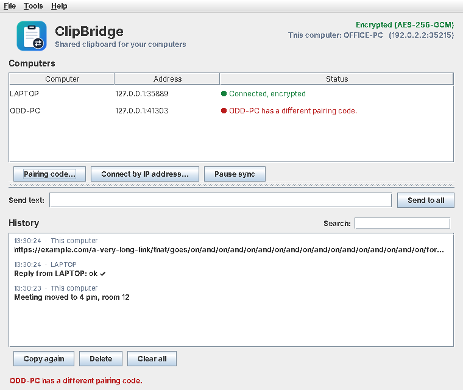

# ClipBridge

**Shared clipboard for your computers.** Copy text on one computer (Ctrl+C) and paste it on another (Ctrl+V).
Computers on the same network find each other automatically, and everything they send is encrypted.

Java 17+ · Swing GUI · TCP/UDP sockets · AES-256-GCM · no libraries needed (JDK only).



## Features

| Feature | How it works |
|---|---|
| Clipboard sync | The clipboard is checked every 0.4 s; new text is sent to every connected computer |
| Automatic discovery | UDP multicast announcements (`239.255.77.88:45454`) every 3 s, on every network adapter |
| Connect by IP | For networks that block multicast (some Wi-Fi, hotspots) |
| Encryption | One shared **pairing code** (16 characters, 80 bits) -> PBKDF2 -> AES-256-GCM |
| Refusal of strangers | A computer with a missing or different code is turned away before any clipboard text is exchanged, and both sides are told why |
| Replay protection | A message that is replayed, reordered, dropped or changed closes the connection |
| Auto-reconnect | A dropped link comes back by itself (about 2 s); unreachable computers are retried every 5 s |
| History | Newest 100 items with the computer they came from, search, copy again, delete. Saved to disk with Java serialization |
| System tray | Closing the window keeps ClipBridge running next to the clock; pop-up when text arrives |
| Pause | Stops sending and receiving without disconnecting |
| Limits | Text up to 1 MB; larger copies are reported, never silently dropped |

## Run it

You need a JDK 17 or newer (check with `java -version`). To install one: `winget install EclipseAdoptium.Temurin.21.JDK`.

```
build.bat skiptests      (Windows)   or   ./build.sh skiptests   (Linux / macOS)
run.bat                  (Windows)   or   java -jar build/clipbridge.jar
```

First start: click **Generate new** in the welcome dialog, then **Save**. On your other computer, type the same code.

> **Windows Firewall:** the first time ClipBridge (or Java) starts, Windows asks whether to allow it on the network.
> Click **Allow access** (tick *Private networks*). Without this the other computer cannot connect to you.

## Demo on ONE computer

`demo_two_copies.bat` starts two separate copies (`Computer-A` on port 5005, `Computer-B` on port 5006). Each has its own settings folder and its own "clipboard" file, so they do not share the real Windows clipboard.

1. Run `build.bat skiptests`, then `demo_two_copies.bat`.
2. In **Computer-A**: Tools -> *Pairing code...* -> **Generate new** -> **Save**.
3. In **Computer-B**: Tools -> *Pairing code...* -> type the same code -> **Save**.
4. Within a few seconds each window lists the other as *Connected, encrypted*. If not, use Tools -> *Connect by IP address...* -> `127.0.0.1`, port `5006` (in A).
5. Type text in **Send text** in one window and press Enter. It appears in the other window's history.
6. To show the security: give B a different code. A and B both show *"... has a different pairing code"* and nothing is shared. Put the right code back and they reconnect by themselves.
7. Afterwards run `demo_two_copies.bat clean`.

## Demo on TWO computers (for the review)

Put both on the same Wi-Fi (a phone hotspot works too). Start ClipBridge on both (installed app or `run.bat`), allow it through the firewall, set the same pairing code, and copy text on one. It shows up on the other.
If the second computer does not appear within about 10 seconds, use **Connect by IP address** with the address shown at the top right of the other computer's window.

## Build the Windows application and installer

`build.bat` needs a JDK 17+ (it includes `jpackage`). It compiles, runs the 61 tests, makes `build\clipbridge.jar`, and then uses **jpackage** to make `dist\ClipBridge\ClipBridge.exe`, a ready-to-run app folder with its own Java runtime and the ClipBridge icon. The user does not need Java installed.

There are two ways to turn that folder into a real installer (`Setup.exe`):

**A. Inno Setup (easiest, recommended).**
1. Run `build.bat`.
2. Install Inno Setup (free, https://jrsoftware.org/isdl.php).
3. Open `installer\ClipBridge.iss` in Inno Setup and press **F9**.
4. `dist\ClipBridge-Setup-1.0.exe` is the installer. It installs without administrator rights, adds a Start menu entry, an optional desktop icon and an optional "start with Windows" entry, and an uninstaller. The icon is the ClipBridge icon on the setup file, the shortcuts, the taskbar and the window.

**B. jpackage + WiX.** Install the WiX Toolset (`winget install WiXToolset.WiXToolset`, then open a new window), run `build.bat installer`, and you get `dist\ClipBridge-1.0.exe`.

**Test the installed app before the review:** install it, start it from the Start menu (not from an IDE or `java -jar`), check the icon in the title bar and the taskbar, set a pairing code, and sync with a second computer or with the two-copy demo.

## Settings and history

Stored in `%APPDATA%\ClipBridge` (`config.properties`, `history.bin`). To start completely fresh, close the app and delete that folder.

## Project layout

```
src/clipbridge/Main.java               start-up and command-line options
src/clipbridge/Branding.java           app name, version, author (change the name here)
src/clipbridge/core/PairingCode.java   generate, check and format the code; PBKDF2 key
src/clipbridge/core/SecureChannel.java AES-256-GCM with message counters
src/clipbridge/core/Node.java          clipboard watcher, TCP server and client, handshake, reconnect
src/clipbridge/core/Discovery.java     UDP multicast announcements
src/clipbridge/core/History.java       history list + serialization (HistoryEntry.java)
src/clipbridge/core/Config.java        settings file
src/clipbridge/core/*Backend.java      real clipboard / file clipboard (for tests and the demo)
src/clipbridge/gui/                    Swing window, dialogs, tray, logo loader, the logo PNGs
test/clipbridge/AllTests.java          61 automated tests (no libraries: java -cp ... clipbridge.AllTests)
assets/clipbridge.ico                  the Windows icon; tools/make_logo.py draws the logo
installer/ClipBridge.iss               Inno Setup script
docs/EXPLAIN.md                        how the code works + questions you may be asked
```

## How it works (short version)

1. Every 0.4 s `Node` reads the clipboard. New text is added to the history and sent to every connected computer.
2. Every 3 s `Discovery` announces `id|port|name` on the multicast group and listens for others. A new computer becomes a *target*; a background loop dials every target that is not connected.
3. **Handshake** (plain, then encrypted): both sides send `HELLO` (random node id, random nonce, "do I have a code", port, name). If a code is missing on either side the link is refused with a clear message. Both derive a **session key** `HMAC(key(code), "ClipBridge session" + nonceA + nonceB)`, so every connection has its own key. The initiator sends a sealed proof; the other side opens it. If that fails the codes differ: it replies `REFUSE` and closes. Then the other side sends its own sealed proof.
4. After that every message (`T` text, `H` heartbeat) is one AES-GCM record. The 12-byte IV is `direction + counter` that both sides count themselves and never send. A replayed, reordered, deleted or altered message no longer decrypts, so the link is closed.
5. When both computers dial each other at the same moment, both apply the same rule (keep the link started by the computer with the smaller id), so exactly one link remains.
6. Remote text is put on the clipboard and remembered as "last seen", so it is not sent straight back (no ping-pong).

## What the encryption protects, and what it does not

**Protects:** other people on the same Wi-Fi cannot read your clipboard text, cannot insert text, cannot replay recorded traffic, and cannot connect without the code. Guessing the code offline is impractical (80 bits plus a slow key derivation).

**Does not protect:** anyone who knows the code (and is on your network) can read your clipboard, so treat it like a password. The code is saved as plain text in `config.properties`, and the clipboard text and history on your own computer are not encrypted. The computer *names* and the existence of ClipBridge are visible on the network (the discovery announcement is not encrypted and contains no clipboard data). Only text is supported (no images or files).

## Troubleshooting

| Problem | What to do |
|---|---|
| The other computer does not appear | Allow ClipBridge in the Windows Firewall (Private networks). Check both are on the same network. Use *Connect by IP address*. |
| "has a different pairing code" | Open *Pairing code...* on both computers and compare the codes. Capital letters, spaces and dashes do not matter. |
| "Port 5005 is already in use" | Another copy is running (look in the tray). Close it, or start with `--port 5010`. |
| Nothing is copied | Check that *Pause sync* is not active. Only text up to 1 MB is shared. |
| Run two copies on one PC | Use `demo_two_copies.bat` (two copies cannot share the one real clipboard). |
